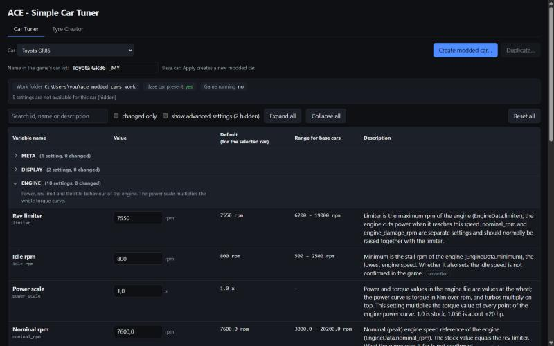

# ACE - Simple Car Tuner

**Tune any Assetto Corsa EVO car in minutes, in one simple table. From your PC or your phone.**

Pick a car, change what matters to the way it drives, and take your own version out on track next to the original. No file hunting, no guesswork, no hex editor.

## Why you will like it

- **Every car of the game.** Select any of the game's cars, install it with one click and start tuning.
- **One simple table.** More than a hundred settings per car with their real names: engine, turbo, gearbox, differential, steering, brakes, springs, dampers, anti-roll bars, ride height, alignment, tyres, driver aids and fuel.
- **Always know where you stand.** Next to every value you see the car's stock default, the range found across the cars of the game and a plain-English description based on the official documentation.
- **Your own cars next to the originals.** Make as many modded cars as you like. They appear in the game's car list right beside the stock car, which is never touched.
- **Your own tyres.** Create tyre compounds and choose which ones a car offers in the garage.
- **Safe by design.** Every install keeps a backup of the previous version, so you can always go back.
- **On your phone, too.** Open the tuner from your phone or tablet on the same Wi-Fi and add it to your iPhone home screen like an app.
- **One double-click to start.** Run `start_tuner.bat` and the tuner opens in your browser.

## Get started

1. You need Windows, **Assetto Corsa EVO** with its **SDK** (both from Steam) and **Python 3.12**.
2. One time only: read the field names out of the SDK with a single command (see the [user guide](USER_GUIDE.md)).
3. Double-click **`start_tuner.bat`**.
4. Pick a car, change some values, press **Create modded car**, start the game and drive.

The full step-by-step guide is in the [user guide](USER_GUIDE.md). The project is young: how each setting feels in the game is still being checked, and settings marked "unverified" in the table are best guesses.

## More

- [User guide](USER_GUIDE.md): installation, every button and the details.
- [Project state](TUNER_SPEC.md): what works, what is verified, what is open.
- [Handover](HANDOVER.md): notes for continuing the work.

## Credits and rights

Not affiliated with KUNOS Simulazioni; requires a legal copy of Assetto Corsa EVO. Car data, field names and game files belong to Kunos and stay out of this repository. Do not publish tuned versions of Kunos' cars.
